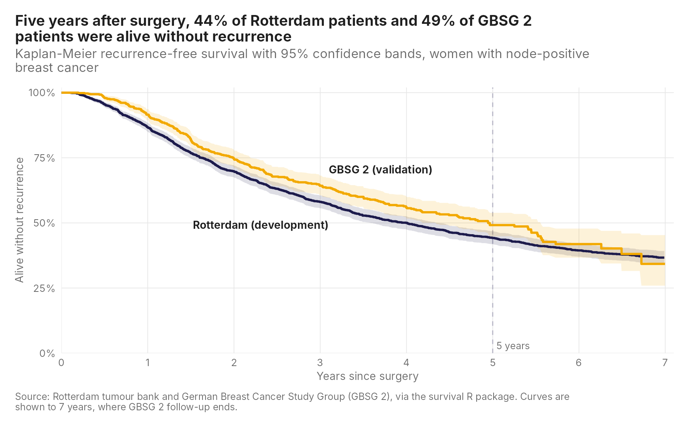
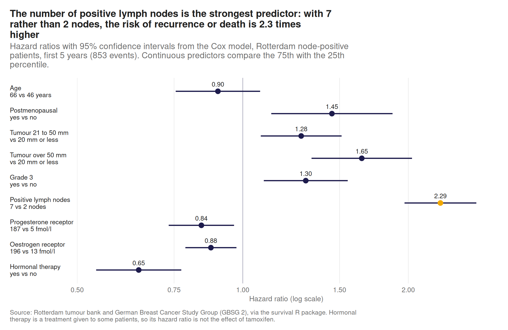
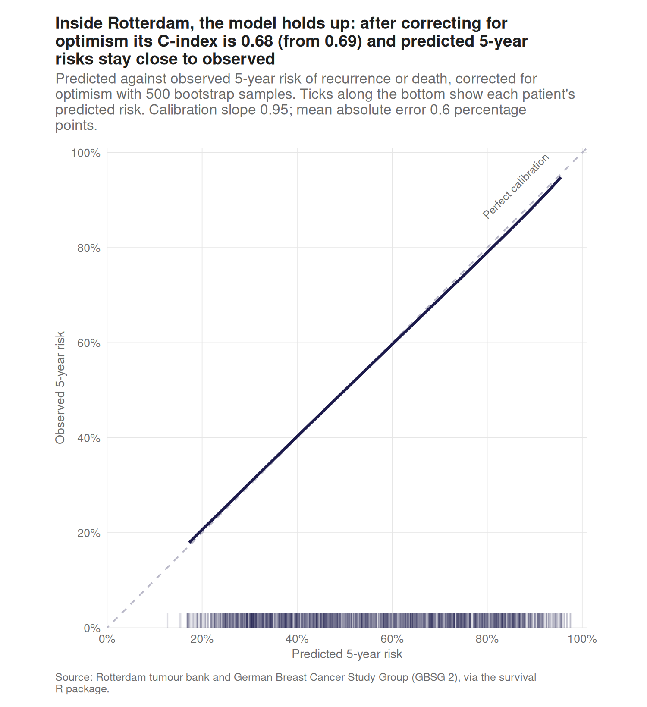
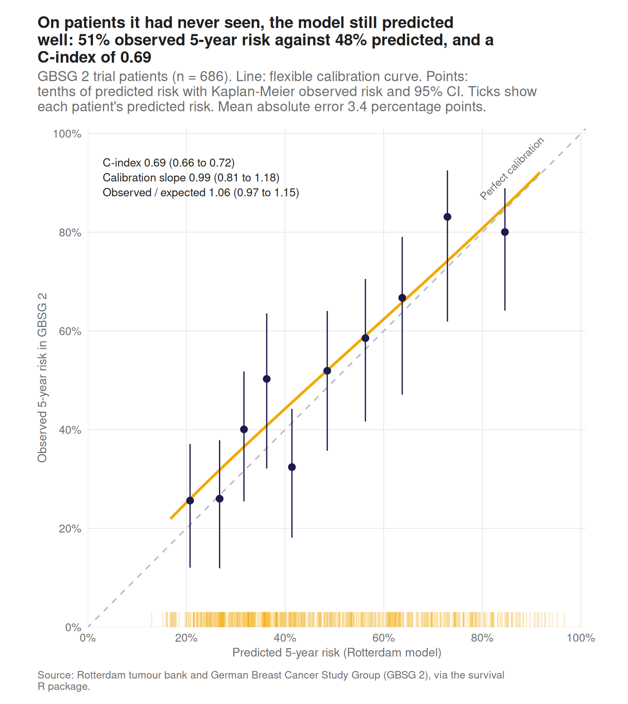
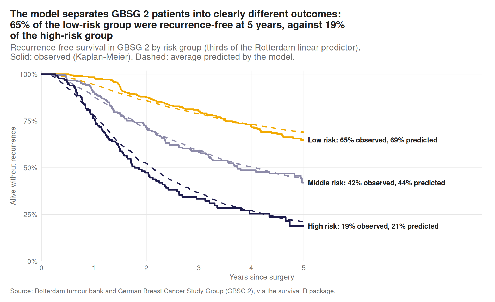
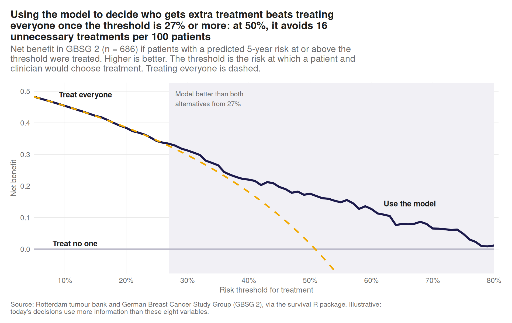

# Does a breast cancer prognostic model still work on new patients?

A model that predicts how likely a breast cancer is to come back can look excellent in the hospital where it was built and still mislead clinicians somewhere else. This project builds a Cox prognostic model for recurrence-free survival in one cohort of women with node-positive breast cancer, then tests it on patients from a separate clinical trial it has never seen: how well it ranks patients, whether its predicted risks match what actually happened, and whether using it would lead to better treatment decisions than treating everyone or no one.

> Work in progress. This README grows as each stage of the analysis is completed.

## Data

Both datasets ship with the [`survival`](https://cran.r-project.org/package=survival) R package, so nothing needs downloading. Using them for development and validation follows Royston and Altman (2013), [External validation of a Cox prognostic model: principles and methods](https://doi.org/10.1186/1471-2288-13-33), *BMC Medical Research Methodology* 13:33.

| Role | Cohort | Patients | Recurrence-free survival events |
|---|---|---|---|
| Development | Rotterdam tumour bank, node-positive patients, surgery 1978 to 1993 | 1,546 | 1,059 |
| External validation | German Breast Cancer Study Group (GBSG 2) trial, recruited 1984 to 1989 | 686 | 299 |

### Definitions and data notes

- **Outcome:** recurrence-free survival (RFS), the time to the first of breast cancer recurrence or death from any cause.
- **Same population:** GBSG 2 only recruited women with cancer in at least one lymph node, so the model is developed on the node-positive Rotterdam patients only.
- **Late deaths:** in Rotterdam, 21 node-positive patients died without a recorded recurrence but after their last recurrence check. A recurrence in that gap could have gone unrecorded, so they are censored at their last check, as in the `survival` package's own example. A sensitivity analysis counts them as events at death instead.
- **Tumour size:** GBSG records size in mm, Rotterdam in three bands (20 mm or less, 21 to 50 mm, over 50 mm), so GBSG sizes are put into the same bands.
- **Grade:** Rotterdam has no grade 1 tumours, so grade enters the model as grade 3 against grades 1 to 2.
- **Chemotherapy:** GBSG has no chemotherapy variable, so it cannot be a predictor.
- **Follow-up:** GBSG follow-up ends at 7.3 years, so predictions are assessed at 5 years.
- No values are missing in either dataset.

## Approach

Reported following the [TRIPOD](https://www.tripod-statement.org/) guideline for prediction model studies.

1. Prepare the development and validation data
2. Describe both cohorts and compare their case mix
3. Develop a Cox model for recurrence-free survival in Rotterdam
4. Internal validation with bootstrapping, to estimate optimism
5. External validation in GBSG 2: discrimination (C-index) and calibration (calibration slope and calibration plot at 5 years)
6. Decision curve analysis: is the model useful for deciding who needs further treatment?
7. Write-up of findings and the TRIPOD checklist

## Progress

- [x] Project setup
- [x] Data preparation
- [x] Cohort description
- [x] Model development
- [x] Internal validation
- [x] External validation
- [x] Decision curve analysis
- [ ] Write-up of findings

## Results so far

### The two cohorts

| Characteristic | Rotterdam (development) | GBSG 2 (validation) |
|---|---|---|
| Patients | 1,546 | 686 |
| Age, years, median (IQR) | 56 (46 to 66) | 53 (46 to 61) |
| Postmenopausal, n (%) | 918 (59%) | 396 (58%) |
| Tumour size 20 mm or less, n (%) | 501 (32%) | 180 (26%) |
| Tumour size 21 to 50 mm, n (%) | 783 (51%) | 453 (66%) |
| Tumour size over 50 mm, n (%) | 262 (17%) | 53 (8%) |
| Grade 3, n (%) | 1,177 (76%) | 161 (23%) |
| Positive lymph nodes, median (IQR) | 4 (2 to 7) | 3 (1 to 7) |
| 1 to 3 positive nodes, n (%) | 764 (49%) | 376 (55%) |
| 4 to 9 positive nodes, n (%) | 515 (33%) | 207 (30%) |
| 10 or more positive nodes, n (%) | 267 (17%) | 103 (15%) |
| Progesterone receptor, fmol/l, median (IQR) | 38 (5 to 187) | 32 (7 to 132) |
| Oestrogen receptor, fmol/l, median (IQR) | 65 (13 to 196) | 36 (8 to 114) |
| Hormonal therapy, n (%) | 339 (22%) | 246 (36%) |
| Chemotherapy, n (%) | 580 (38%) | Not recorded |
| Recurrences or deaths, n | 1,059 | 299 |
| Median follow-up, years | 9.1 | 4.5 |
| Recurrence-free at 5 years, % (95% CI) | 44 (42 to 47) | 49 (45 to 54) |

The validation patients were broadly similar but had less advanced disease on several measures. They were slightly younger, had fewer tumours over 50 mm (8% against 17%), lower oestrogen receptor levels, and more of them had hormonal therapy (36% against 22%), because the GBSG 2 trial randomised women to tamoxifen or no tamoxifen.

The biggest difference is grade: 76% of Rotterdam tumours were grade 3, against 23% in GBSG 2. Rotterdam records no grade 1 tumours at all, so this may partly reflect how grade was recorded in each source rather than how aggressive the cancers were. If so, grade may carry a different meaning in the two cohorts, which is exactly the kind of difference external validation is designed to catch.



Five years after surgery, 44% of Rotterdam patients (95% CI 42% to 47%) and 49% of GBSG 2 patients (45% to 54%) were alive without recurrence. Follow-up is much shorter in GBSG 2 (median 4.5 years against 9.1), which is why predictions are judged at 5 years.

### The prognostic model

The model was fitted to the Rotterdam patients only, with eight predictors chosen in advance from clinical knowledge rather than by statistical selection, which tends to overfit. Age, number of positive nodes and progesterone receptor are modelled with restricted cubic splines, so their effects need not be straight lines. Follow-up is censored at 5 years, the time point the model predicts. With 853 events and 12 parameters there are about 71 events per parameter, comfortably enough to avoid overfitting.



- **Lymph nodes dominate.** A patient with 7 positive nodes has 2.3 times the hazard of recurrence or death of a patient with 2 (95% CI 2.0 to 2.7).
- **Larger tumours, grade 3 and being postmenopausal raise the risk**; higher hormone receptor levels lower it.
- **Hormonal therapy has a hazard ratio of 0.65.** It is a treatment rather than a patient characteristic, and was not randomised in Rotterdam, so this is not an estimate of what tamoxifen does.
- **The apparent C-index is 0.69.** This is measured on the same patients the model was built on, so it is optimistic; the next stages estimate how much.
- **Proportional hazards do not fully hold.** The effects of hormone receptors, nodes and tumour size are stronger early in follow-up than later (global test p < 0.001). Censoring at 5 years limits the problem, and the external validation shows whether it matters for 5-year predictions.
- **The late-deaths decision does not matter.** Counting the 21 late deaths as events instead changes no coefficient by more than 0.02 and leaves the C-index at 0.689.

The full model, including coefficients, spline knots and the baseline 5-year survival, is in [`output/tables/model_coefficients.csv`](output/tables/model_coefficients.csv), so others can reproduce its predictions. Predicted 5-year recurrence-free survival is the baseline value raised to the power exp(linear predictor minus its centre); the splines use the restricted cubic spline basis from the [`rms`](https://cran.r-project.org/package=rms) package.

### Internal validation

A model always looks better on the patients it was built on. To estimate by how much, the whole model was refitted in 500 bootstrap resamples of the Rotterdam data and each refit was tested on the original data. The average drop in performance, the optimism, is subtracted from the apparent performance.

| Measure | Apparent | Optimism | Corrected |
|---|---|---|---|
| C-index | 0.689 | 0.005 | 0.684 |
| Calibration slope | 1.000 | 0.045 | 0.955 |
| Mean absolute calibration error at 5 years | | | 0.6 percentage points |



- **Very little optimism.** The C-index barely moves (0.689 to 0.684), as expected with 71 events per parameter and no data-driven predictor selection.
- **Predictions are slightly too extreme.** A calibration slope of 0.955 means risks would need shrinking about 5% towards the average for new patients from the same population. That is small enough not to need correcting.
- **Predicted risks match observed risks closely** across the whole range, from about 13% to 98% predicted 5-year risk, with an average error of 0.6 percentage points.
- **A C-index of 0.68 is moderate.** The model separates patients, with half of them predicted between 38% and 74% risk, but it is far from perfect, as is typical for prognostic models built on routine clinical variables.

Internal validation only shows the model is not overfitted to Rotterdam. It says nothing about patients treated elsewhere, which is what the external validation tests.

### External validation in GBSG 2

The Rotterdam model was applied unchanged to the 686 GBSG 2 trial patients, who played no part in building it. Nothing was re-estimated: not the coefficients, and not the baseline risk.

| Measure | Estimate (95% CI) | What good looks like |
|---|---|---|
| Harrell's C-index | 0.69 (0.66 to 0.72) | As high as possible; 0.5 is chance |
| Uno's C-index | 0.68 (0.65 to 0.71) | Less affected by length of follow-up |
| Observed / expected 5-year risk | 1.06 (0.97 to 1.15) | 1 |
| Calibration slope | 0.99 (0.81 to 1.18) | 1 |
| Mean absolute calibration error | 3.4 percentage points | 0 |



- **The model transports well.** Its C-index in GBSG 2 (0.69) is the same as in Rotterdam, so it ranks new patients by risk just as well as the ones it was built on.
- **Its risks are on the right scale.** On average it predicted a 48% risk of recurrence or death by 5 years, and 51% happened (Kaplan-Meier). An observed-to-expected ratio of 1.06 means it slightly underpredicts, but the confidence interval includes 1.
- **Its predictions are not too extreme.** A calibration slope of 0.99 means high-risk predictions are not too high and low-risk ones not too low.
- **It separates patients into clearly different outcomes.** Using the Rotterdam thirds of risk, 65% of GBSG 2's low-risk group were alive without recurrence at 5 years, against 19% of the high-risk group, each within 4 percentage points of what the model predicted. Half of GBSG 2 patients fell into the low-risk group, which fits their less advanced disease.



**Where the model is not quite right.** Following Royston and Altman, I tested whether adding the predictors back on top of the model's risk score improves the fit in GBSG 2. Together they do, a little (p = 0.04), and almost all of that comes from progesterone receptor (p = 0.006): high progesterone receptor levels are more protective in GBSG 2 than the model assumes. One possible reason is treatment: hormonal therapy works through these receptors, and was given to 36% of GBSG 2 patients against 22% in Rotterdam. Despite the large difference in how often grade 3 was recorded, there is no evidence that grade's effect differs between the cohorts (p = 0.36).

### Would using the model help decisions?

Accurate predictions are not automatically useful. Decision curve analysis asks a practical question: if patients whose predicted 5-year risk is at or above some threshold were offered additional treatment, would that do more good than offering it to everyone, or to no one?

The threshold is where a patient and clinician would choose treatment. At 50%, they judge that treating one patient who would have recurred is worth treating one who would not. Net benefit counts the correctly treated patients and subtracts the unnecessarily treated ones, weighted by the threshold. It is estimated in GBSG 2 with Kaplan-Meier, so censored patients are handled properly, and it is calculated directly in the code rather than with a package, so every step is visible.



| Threshold | Patients the model would treat | Net unnecessary treatments avoided per 100, compared with treating everyone |
|---|---|---|
| 20% | 97% | none |
| 30% | 78% | 3.5 |
| 40% | 57% | 5.9 |
| 50% | 43% | 15.9 |
| 60% | 31% | 23.8 |

- **Below about 27%, the model adds nothing.** About half of these patients recur within 5 years, so at low thresholds treating everyone is as good as using the model.
- **From 27% upwards, the model is better than both alternatives.** At a 50% threshold it would treat 43% of patients. Its net benefit is equivalent to avoiding about 16 unnecessary treatments per 100 patients compared with treating everyone, with no extra missed recurrences.
- **This is illustrative.** The data are from the 1980s, and treatment decisions today use more information, such as HER2 status and genomic tests, than these eight variables.

## Repository structure

```
R/                 analysis scripts, run in numbered order (plot_theme.R holds the chart style, model_setup.R the shared model settings)
data/processed/    analysis datasets built by script (not tracked)
output/figures/    charts used in this README
output/tables/     summary tables and model results
```

## Reproducing the analysis

Requires R 4.3 or later. Package versions are pinned with [renv](https://rstudio.github.io/renv/).

From the project root:

```r
renv::restore()
```

```bash
Rscript R/01_prepare_data.R      # build the development and validation datasets
Rscript R/02_describe_cohorts.R  # Table 1 and recurrence-free survival by cohort
Rscript R/03_develop_model.R     # fit the Cox model in Rotterdam
Rscript R/04_internal_validation.R  # bootstrap optimism and calibration (about a minute)
Rscript R/05_external_validation.R  # discrimination and calibration in GBSG 2
Rscript R/06_decision_curve.R       # net benefit in GBSG 2
```

## Author

Juliet Asantewaa Sarpong, PhD researcher in Statistics, University of Edinburgh. [Portfolio](https://asantewaah.github.io)
